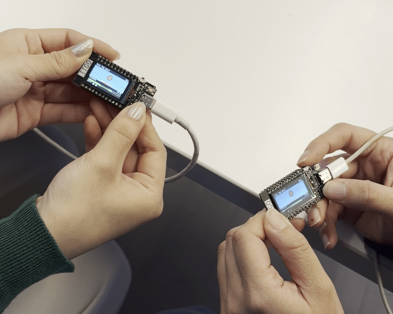

# Row the Boat

## Project Overview

Row the Boat is a two-player cooperative game we built using two ESP32 Display boards and ESP-NOW communication. The game combines the idea of rowing a boat across a lake with a three-legged race, where both players have to work together and coordinate their movements to reach the finish line.

Like a three-legged race, players take turns pressing their buttons in an alternating pattern to move the boat forward. If they press out of order, the boat starts drifting, making it harder to reach the finish line without capsizing. The goal is to work together, stay in sync, and get the boat safely across the lake before time runs out.

## Our Design Goals

We wanted to create a multiplayer game that would be fun to play while also exploring how two ESP32 boards can communicate with each other. We decided to make it cooperative because we liked the idea of having both players work toward the same goal instead of competing against each other.

For the visual design, we wanted the game to have a cartoon-like look. We used a bird's-eye view of a wooden boat on blue water, with water ripples and a progress bar to show how far the players have traveled. We also added different changes to make it easier to tell when the boat is drifting, when players win, and when the boat capsizes.

## How It Works

The game uses ESP-NOW to let the two ESP32 boards communicate wirelessly without needing Wi-Fi. PLAYER_ID 0's board acts as the host and manages the main game, while PLAYER_ID 1 sends its button presses to the host. Both players use the buttons on their boards to take turns rowing.

To move the boat forward, players have to alternate their button presses. Each correct alternating press brings them one step closer to the finish line. If the same player presses twice in a row, the boat starts drifting. Players can correct the drift by having the other player press next, but if the drift reaches 2, the boat capsizes, and the players have to try again

Players have 45 seconds to reach the finish line. They can either make it across in time, run out of time, or capsize if they build up too much drift.

## Components used

Hardware 
- 2 ESP32 T-Display boards
- 2 USB cables

Software 
- Arduino IDE
- ESP-NOW

Both ESP32 boards use the same Arduino sketch, but each one has a different player ID. Player 1 acts as the host and manages the main game logic using functions like `processPress()`, `sendState()`, and `endGame()`. Player 2 sends its button presses through `sendPress()`, which Player 1 receives through `onReceive()`. The `applyReceivedState()` function then updates Player 2's board with the latest game information so both screens stay synchronized.

To play, upload the Arduino sketch to both ESP32 boards using Arduino IDE. Make sure both boards have the same team ID (7) but different player IDs (0 and 1). Once both boards are on and connected, they can communicate with each other through ESP-NOW, and the game is ready to play.

## Demonstration

Here is a short video of the game in action:

## Visual Designs

### Starting Screen

### Gameplay Screen

### Drift Screen

### Game Over Screen

## AI Support Used

We used ChatGPT (GPT-6) for occasional coding help and troubleshooting throughout the project. It helped us understand parts of the professor's original ESP-NOW starter code and figure out how to adapt it for our cooperative game. Most of our questions came up while testing the game on both boards and trying to fix issues we noticed during gameplay.

One issue we ran into was the screen flashing whenever a player pressed a button. We looked at how the screen was being updated and adjusted the code so it only redraws the parts of the display that change during gameplay. This helped prevent the screen from flashing every time a button was pressed.

Another challenge was getting both boards to stay synchronized. We worked with functions like `onReceive()` and `sendState()` to understand how button presses and game updates were being shared through ESP-NOW.

Two examples of prompts we used were:

- "Which function is causing the screen to flash when a button is pressed, and how can we change it so there are no flashes?"
- "How can we make sure both ESP32 boards display the same game state when one player presses a button?"

We used the explanations to better understand the code and make our own adjustments. We then uploaded the sketch to both boards and tested the changes together, making further adjustments whenever something didn't work as expected.
